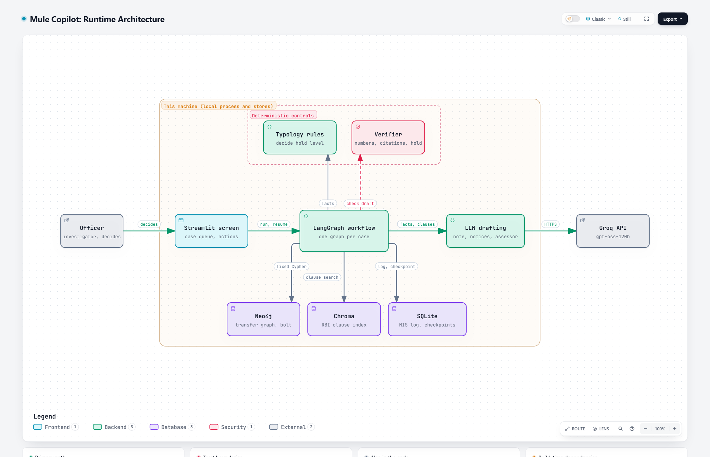
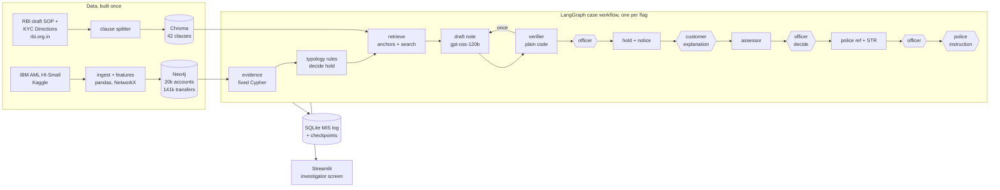

# Mule Copilot

An agentic copilot for mule-account investigation, built against RBI's September 2026 draft SOP
(draft KYC Amendment Directions 2026, Annex III). Flagged account in, cited case note out, human
approval, then customer notice, police (NCRP) reference or STR draft, all on the SOP's clock and
all logged.

> Built against a **draft**. The final directions may change; this is not a compliance claim.
> Synthetic data only (IBM's public AML dataset). No bank data, code or process details are used.

## Why

- **About ₹19,800 crore** reported lost to cyber fraud in India in 2025
  ([I4C data via IANS](https://ianslive.in/indians-lose-over-rs-52976-crore-to-cyber-frauds-over-six-years-report--20260103154943)).
- **Over 27 lakh** first-layer mule accounts identified through I4C's Suspect Registry by January 2026
  ([The420.in](https://the420.in/?p=91261)).
- **1 April 2027**: proposed start of RBI's SOP on suspected money mule accounts
  ([draft](https://www.rbi.org.in/scripts/bs_viewcontent.aspx?Id=5170)). Every flag will need a
  hold, a notice, a 20-day explanation window, a decision within 10 or 30 days, a police reference
  or release, an MIS record and often an STR.

## Results

Measured on frozen test sets: 30 accounts (20 laundering, 10 clean, half of the clean ones drawn
from the busiest 10% of accounts) and 15 synthetic customer explanations. Model `openai/gpt-oss-120b`.
Details, raw outputs and the hand-check sheets: [evals/results.md](evals/results.md).

| Metric | Test set | Result |
|---|---|---|
| Detection: any hold (precision / recall) | 30 accounts | With NCRP linkage **74% / 70%** (14 of 20 caught, 5 of 10 clean held). Without: 71% / 60% |
| Detection: account-level hold (precision / recall) | 30 accounts | With linkage **92% / 55%**. Without: 80% / 20% |
| Citation accuracy | 15 notes, 80 citations | All 80 exist. Hand-checked: **69 support the claim**, 8 partly, 3 do not |
| Verifier catch rate | 30 notes | As run: **4 of 8** drafts sent back had a real error (a misread yen amount, two wrong percentages, an uncited note); the other 4 were verifier bugs, fixed since |
| Explanation-assessor agreement | 15 explanations | **12 of 15**. It never released a mule account; it kept 3 honest customers on hold |
| Time per case | 30 accounts | **Median 30 s** (max 90 s) from account ID to verified note, against about 90 minutes assumed for a manual write-up; about 5,400 LLM tokens per note |

What the numbers say:

- **Rules catch most mule-like accounts, and linkage matters most.** Recall rises from 60% to 70%
  with the NCRP linkage indicator, and account-level holds from 20% to 55%. The 6 misses show no
  unusual transaction shape at all; graph features alone won't find them.
- **Clean accounts get held, at the lighter level.** 4 of the 5 clean accounts held come from the
  busiest-decile hard negatives, and 4 of the 5 holds are on flagged amounts only. The explanation
  step is what clears them; 1 clean account drew an account-level hold.
- **The assessor errs toward caution.** All 3 disagreements are customers paying out of an existing
  balance. `rapid_forward_24h` cannot see opening balances, so small credits look forwarded. In one
  of the three the assessor also caught a real inconsistency in the test explanation itself ("twice
  a week" against near-daily payments). Labels were frozen before the run and are reported as is.
- **The verifier earns its place, and the eval improved it.** It caught a mangled amount and wrong
  percentages that would otherwise have reached the officer. Its false alarms came from two bugs
  (hours inside ISO timestamps, field names in brackets). With those fixed, re-checking the same
  saved drafts gives 4 of 4 send-backs real and no note wrongly flagged; that re-check is not
  independent, since the fixes came from this set.
- **Hold level is never misstated**: in all 30 notes the stated hold matches the rules.

## Architecture



Runtime view, every component linked to its source lines at a pinned commit. Interactive version
(download and open in a browser):
[`mule-copilot-runtime.html`](.archify/architecture-mule-copilot-runtime-20261030-124223/mule-copilot-runtime.html),
built with [Archify](https://github.com/tt-a1i/archify) from
[`candidate.json`](.archify/architecture-mule-copilot-runtime-20261030-124223/candidate.json).

Case workflow, one per flag:



Hexagons are pauses where a person acts; the case resumes from its checkpoint, days later if need be.

## SOP requirement to implementation

| SOP (draft Annex III) / KYC Directions | Where |
|---|---|
| Para 3: suspected mule transaction, indicators (a) unusual for profile, (b) linkage to reported account | `typology.py`: five transaction-shape signals for (a), NCRP linkage for (b) |
| Step 1: hold immediately; account-level hold only as last resort (para 6(ii)) | Hold level from the rules: 1 signal amounts only, 2+ account level; `place_hold` |
| Step 2: notify with reasons, removal process, officer contact | `documents.py` customer notice, verified; grievance route from para 8 |
| Step 3: 20 days to explain | `clock.py`; pause for the customer's explanation |
| Step 4: decide within 10 days of explanation (30 if none); remove, or continue and refer via NCRP | `assessor.py` advises; officer decides; police reference drafted |
| Steps 5 and 6: follow police instruction, else release on the 31st day; 60-day cap | Pause for police; `clock.py` release date |
| Para 6: objective parameters that minimise flagging genuine accounts | Thresholds from the bank's book, not labels; fast route to clear honest customers |
| Para 7: centralised MIS, records, STRs continue | `case_log.py`; STR narrative drafted at referral |
| KYC para 68: mule accounts, STR filing | STR narrative; `KYC-CB-2025 para 68` cited |
| KYC para 54: reporting is confidential | Customer documents checked for any mention of an STR or FIU-IND |

More: [production design (one page)](docs/production-design.md) · [demo script](docs/demo-script.md) ·
[eval details](evals/results.md)

## Setup

Python 3.11+ and either Docker or the portable Neo4j script (Windows, no admin rights needed).

```powershell
python -m venv .venv
.venv\Scripts\pip install -e ".[dev]"
copy .env.example .env          # then add your GROQ_API_KEY

# Neo4j: either
docker compose up -d
# or, without Docker (downloads Temurin JDK 21 + Neo4j Community into .tools\)
powershell -ExecutionPolicy Bypass -File scripts\neo4j.ps1 setup
powershell -ExecutionPolicy Bypass -File scripts\neo4j.ps1 start
```

## Build the graph

```powershell
.venv\Scripts\python -m mule_copilot.ingest       # download HI-Small from Kaggle, subsample
.venv\Scripts\python -m mule_copilot.features     # fan-in/out, pass-through, rapid forwarding, cycles, Louvain
.venv\Scripts\python -m mule_copilot.eval_set     # frozen eval set + simulated NCRP "reported" list
.venv\Scripts\python -m mule_copilot.graph_store  # load into Neo4j
.venv\Scripts\python -m mule_copilot.risk_profile <account_id>
```

## Run the copilot

```powershell
.venv\Scripts\python -m mule_copilot.corpus                      # fetch RBI texts, split into clauses, embed
.venv\Scripts\python -m mule_copilot.corpus "time to submit explanation"   # try retrieval
.venv\Scripts\streamlit run src\mule_copilot\app.py              # investigator screen
.venv\Scripts\python -m mule_copilot.agent 223-811EDA940         # whole SOP in the terminal, prompts at each pause
.venv\Scripts\python -m mule_copilot.agent 223-811EDA940 --auto --date 2026-11-02   # scripted run
.venv\Scripts\python -m mule_copilot.agent 223-811EDA940 --note-only --no-linkage   # note only (evals)
```

Notes land in `data/processed/notes/<account>.md`, with a `.json` beside each holding the evidence,
cited clauses, every draft and its verifier errors and the time taken. The MIS log is
`data/processed/mis.sqlite`; LangGraph checkpoints are in `data/processed/checkpoints.sqlite`.

## Data

IBM [Transactions for Anti Money Laundering](https://www.kaggle.com/datasets/ealtman2019/ibm-transactions-for-anti-money-laundering-aml),
`HI-Small` file: 5 million synthetic transactions, 370 labelled laundering patterns (fan-in, fan-out,
cycle, scatter-gather, gather-scatter, stack, bipartite, random).

The subsample has two kinds of "in-scope" account, and keeps every transaction of each:

- every account in a labelled pattern with at most 200 transfers (3,138 of 3,170; the 32 busier
  ones stay as boundary nodes), and
- a label-blind random **background** sample of 2,000 accounts, standing in for the bank's book.
  About 1.6% of it turns out to be laundering, as you'd expect from a random draw.

Result: 150,642 transactions (140,865 after dropping self-transfers), 20,393 accounts, 5,124 in
scope. Counterparties outside the core are loaded as boundary nodes with partial features.
Ground-truth labels are kept in a separate file and never loaded into Neo4j, so the copilot cannot
read them.

## Eval set

[`evals/eval_accounts.csv`](evals/eval_accounts.csv), frozen with seed 42:

- **20 laundering**: in-scope pattern members with at least 2 laundering transactions (accounts
  touched by a single laundering transfer look like ordinary counterparties, not mules), sampled
  round-robin across the 8 pattern types. 16 pass-through, 2 sink, 2 source.
- **10 clean**: in-scope, no laundering transactions. 5 from the busiest decile (hard negatives),
  5 random.

## Features

| Feature | Definition | Mule signal |
|---|---|---|
| `fan_in_48h` / `fan_out_48h` | Most distinct senders / receivers in any 48-hour window | Many small credits collected, or quickly dispersed |
| `pass_through_ratio` | min(in, out) / max(in, out), in USD | Money in goes straight out |
| `rapid_forward_24h` | Share of inbound USD sent out again within 24 hours, matching outflows to the oldest inflows first | Money doesn't stay: the classic mule signature |
| `cycles_3_5` | Directed simple cycles of length 3 to 5 through the account | Round-tripping |
| `community_id` / `community_size` | Louvain community on the transfer graph | Ring membership |

Each feature also has a `_pctl` value: the share of background accounts with a strictly lower
value (so 0 cycles ranks 0, and any cycle ranks above every background account). Features are
computed in Python (pandas, NetworkX) and written to Neo4j, so the Graph Data Science plugin is
optional.

Excerpt of `python -m mule_copilot.risk_profile 223-811EDA940` (a cycle and fan-in pattern member):

```
Feature                                  Value  Percentile
Fan-in, 48h (distinct senders)               3       82.7%
Fan-out, 48h (distinct receivers)            2       70.3%
Pass-through ratio                      0.8149       97.6%
Cycles of length 3-5                         8      100.0%
Cycle: 223-811EDA940 -> 48308-811ED7DF0 -> 119-81235E8B0 -> 148389-811EDAA30 -> 223-811EDA940
```

## Sources

Fetched as HTML from rbi.org.in and split into 42 clauses, each with a stable ID that notes cite:

| Source | Status | Clauses |
|---|---|---|
| [Draft RBI (KYC) Amendment Directions, 2026](https://www.rbi.org.in/scripts/bs_viewcontent.aspx?Id=5170) (11 Sep 2026), incl. Annex III SOP on suspected money mule accounts | Draft; comments closed 2 Oct 2026; proposed start 1 Apr 2027 | Every SOP paragraph, each step 1 to 6, each definition, each internal-policy item, e.g. `SOP Annex III para 5 step 3` |
| [RBI (Commercial Banks – KYC) Directions, 2025](https://www.rbi.org.in/scripts/BS_ViewMasDirections.aspx?id=13141) (updated 1 Oct 2026) | In force | Para 68 (money mules), 39 to 41 (monitoring), 50 (records), 52 to 55 (FIU-IND reporting), 5(1)(xviii) (suspicious transaction) |

Also kept for reference: the [consultation notice](https://rbidocs.rbi.org.in/rdocs/PublicConsultation/PDFs/C2R50511092026B2AFC9BDCF294823A302C9E2EF58667B.PDF)
and [press release](https://rbi.org.in/Scripts/BS_PressReleaseDisplay.aspx?prid=63587).

FIU-IND's guidance on mule accounts was planned as a third source for red-flag indicators. No public
copy could be found (it appears to go to reporting entities only), so it is not used. The SOP's own
definition of a suspected money mule transaction supplies the indicators instead.

Clauses are embedded with `BAAI/bge-small-en-v1.5` into a local Chroma store. Small embedding models
are imperfect on legal text, so each typology signal also pins its "anchor" clauses, and retrieval
only adds context on top.

## How a mule is identified

The SOP (Annex III para 3) defines a suspected money mule transaction as one of ₹1,000 or more,
flagged by monitoring, on indicators such as **(a)** being unusual for or disproportionate to the
account holder's declared profile, or **(b)** linkage to an account already reported as a money mule.

**Rules decide; the LLM only writes.** Thresholds come from the background sample, never the labels:

| Signal | Rule | SOP indicator |
|---|---|---|
| Collection | `fan_in_48h` in the top 5% of the book | (a) |
| Dispersal | `fan_out_48h` in the top 5% | (a) |
| Pass-through | `pass_through_ratio` ≥ 0.8, money both in and out | (a) |
| Rapid forwarding | `rapid_forward_24h` in the top 5% | (a) |
| Round-tripping | at least one 3 to 5 cycle | (a) |
| Linkage | transfers with an account on the NCRP "already reported" list | (b) |

IBM's data has no declared customer profile, so for (a) the bank's book stands in for it.

**Hold level** follows the SOP: no signal, no hold; one signal, a hold on the flagged amounts and a
request for an explanation (Annex III para 4 step 1, para 5 step 3); two or more, an account-level
hold, which the SOP allows only as a last resort (para 6(ii)).

**The NCRP list is simulated.** A random 30% of pattern accounts, never including an eval account,
stand in for accounts already reported by fraud victims. This uses labels on purpose, because in
practice that is how first-layer mules are found, so every result is reported with and without it.

On held-out accounts (eval set and reported accounts excluded):

| | Mule-like laundering (762) | Clean (1,958) |
|---|---|---|
| Collection | 10.6% | 2.6% |
| Dispersal | 17.5% | 4.8% |
| Pass-through | 23.8% | 2.4% |
| Rapid forwarding | 18.2% | 4.9% |
| Round-tripping | 8.3% | 0.0% |
| Linkage | 58.1% | 1.1% |
| **Any hold**, without linkage | 58.3% | 13.1% |
| **Any hold**, with linkage | 78.6% | 13.6% |
| **Account-level hold**, without linkage | 18.1% | 1.6% |
| **Account-level hold**, with linkage | 43.8% | 2.0% |

Transaction-level holds are the triage tier: the customer's explanation is what clears honest
customers quickly. Account-level holds are rare on clean accounts.

## Case-note agent

```
intake → evidence → typology → retrieve → draft → verify → officer review → end
                                            ↑______| (once, with the errors)
```

- **Evidence**: fixed Cypher queries only (account facts, last 15 transfers, example cycles,
  reported counterparties). No free-form queries.
- **Draft**: Groq `openai/gpt-oss-120b`, temperature 0, told to copy numbers rather than compute them
  and to cite only the clauses it was given. Sections: account summary, evidence, patterns matched,
  red flags and SOP basis, recommended hold level, confidence.
- **Verifier** (plain code): every number in the note must appear in the evidence or the cited
  clauses (rounding and ratio-as-percentage allowed); every `[clause ID]` must exist; at least one
  must be cited. A failing draft goes back once with the errors, then is flagged to the officer.
  Example catch: a first draft summed several transfers into "≈ USD 115,000", a number in no record.
- **Officer review**: LangGraph `interrupt()`; the officer approves, edits or rejects, and the
  decision is stored with the case.
- **Hold-level check**: a note (or customer notice) that describes an account-level hold when the
  rules recommend holding only the flagged amounts is sent back too.

## SOP workflow

One LangGraph graph per case, from flag to closure. Square brackets are pauses; the case resumes
from a SQLite checkpoint, so weeks can pass between steps. Each resume carries the date it happens on.

```
note ─[officer: review]─┬─ no hold / rejected ─────────────────────────────────────────── closed
                        └─ hold → customer notice ─[customer: explanation]─ assess ─[officer: decide]
                                ┌──────────────────────────────────────────────────────────┘
                                ├─ remove ──────────────────────────────────── hold removed, closed
                                └─ continue → police reference + STR ─[officer: approve]─ refer
                                       ─[police: instruction?]─┬─ yes → act on it, closed
                                                               └─ no  → hold removed on day 31, closed
```

**SOP clock** (`clock.py`, plain code, unit-tested against the SOP's own numbers):

| Deadline | Rule | SOP |
|---|---|---|
| Notify customer | same day if digital, else by end of next day | para 4 step 2 |
| Explanation due | hold + 20 days | para 5 step 3 |
| Bank decision due | explanation + 10 days, or hold + 30 if none arrives in time | para 5 step 4 |
| Release if police don't instruct | reference + 30 days ("the 31st day", counting the reference date as day 1) | para 5 step 6 |
| Maximum hold | hold + 60 days | para 5 |

The "31st day" reading is the one that keeps the SOP's own sum (up to 30 days for steps 3 and 4, plus
up to 30 for steps 5 and 6) within 60. Late explanations and late decisions are logged as breaches.

**Explanation assessor**: compares the customer's explanation with the graph evidence and
recommends remove or continue, listing what the evidence supports and what it leaves unexplained.
It knows the SOP's definition of a mule account ("on behalf of another person"), so "my friend's
account was blocked, so I paid his suppliers" does not pass however well the numbers match.
Advisory only; the officer decides.

**Documents**: the customer notice (reasons, how to get the hold removed, officer contact,
grievance route), police reference via NCRP-CFCFRMS, and STR grounds of suspicion are drafted by the
LLM and verified like the note. Customer documents are also checked for any mention of an STR,
FIU-IND or money laundering, because the fact of reporting is confidential (KYC Directions para 54).
Removal and continuation notices are fixed templates.

**MIS log** (`case_log.py`, SQLite): every step with its case date and actor (system, copilot,
officer, customer, police), every document with its verifier result, and per-case deadlines, as
SOP para 7 asks for.

**Customer explanations for evals**: [`evals/explanations.csv`](evals/explanations.csv) has 15
synthetic explanations. 8 fit their account's evidence (flagged clean accounts, expected: remove)
and 7 do not (flagged laundering accounts, expected: continue), marked easy, medium or tricky.

**Investigator screen** (`app.py`): case queue sorted by the next SOP deadline, an action panel for
whichever pause the case is at, the case note, a graph of counterparties (reported accounts and
cycles highlighted), documents, the MIS log and the evidence. Dates are simulated from the sidebar.

## Limitations

- **Community size is a sampling artefact here.** Whole laundering patterns are kept while the
  background accounts' neighbours are truncated, so pattern accounts sit in communities of about
  60 and clean ones in communities of about 4. It is stored for the graph view but is not used for
  scoring, because it would inflate detection numbers.
- Cycles are structural (any order of timestamps), not time-respecting.
- Amounts are converted to USD with exchange rates implied by the dataset's own cross-currency
  transfers.
- No declared customer profile exists in the data, so SOP indicator (a) is proxied by the bank's
  book. A real deployment would compare against KYC-declared income and occupation.
- The linkage indicator relies on a simulated NCRP list built from labels (see above).
- The SOP's ₹1,000 floor is not applied: IBM amounts are in mixed currencies, not rupees.
- The verifier checks that every number exists in the evidence, not that it is attached to the right
  label. During development one note gave the fan-in percentile next to the fan-out count.
- Citations can be decorative: 11 of 80 hand-checked citations only partly support, or do not
  support, the sentence they sit in (for example a monitoring paragraph cited for a threshold).
  The verifier checks that a clause exists, not that it fits.
- `rapid_forward_24h` ignores opening balances, which IBM's data does not have. Accounts that spend
  an existing balance while receiving small credits look like rapid forwarders; this drives the
  assessor's 3 disagreements and 2 of the 5 clean accounts held.
- The 15 explanations and their labels were written by the author; they are a smoke test of the
  assessor, not a benchmark.
- Dates are simulated; the workflow does not wait on a real calendar or send real messages.

## Next

- Shared identifiers (phone, device, IP, address) in the graph: the strongest real-world mule
  signal, absent from IBM's data.
- Opening and running balances in the rapid-forwarding feature, so spending an existing balance is
  not mistaken for forwarding.
- A citation-fit check: does the cited clause actually support the sentence it sits in?
- Compare against the KYC-declared profile (income, occupation) for SOP indicator (a).
- Time-respecting cycles, and the SOP's ₹1,000 floor once amounts are in rupees.
- A learned risk score calibrated on confirmed cases, with the current rules kept as guardrails.
- Check that each number in a note sits next to the right label, not just that it exists.
- A supervisor with specialist agents (evidence, typology, drafting, assessment).
- Free-form questions over the graph (text-to-Cypher), read-only and logged.
- Tracing and evaluation dashboards (LangSmith or Langfuse).
